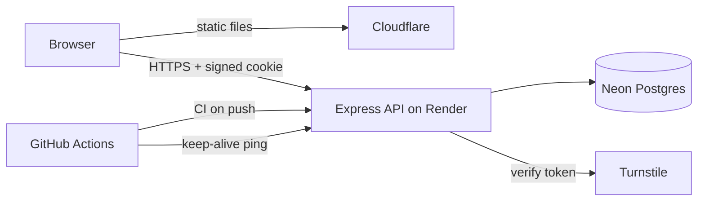
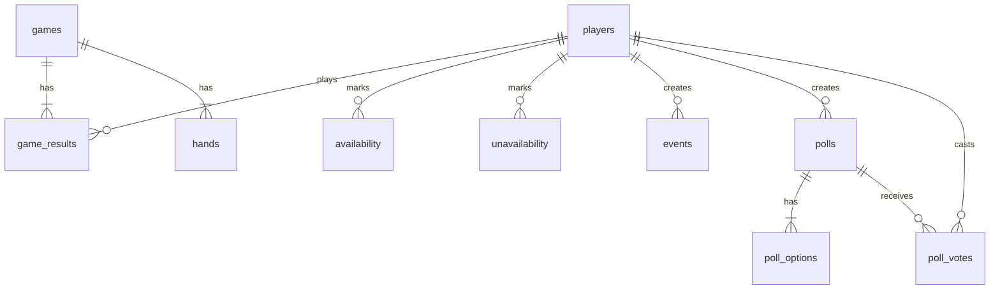

# 3PM League


A full-stack web app that runs a 20-person Hong Kong mahjong league: players self-schedule games on a shared calendar, report scores, and track standings, while an algorithm suggests weekly tables where **nobody plays the same opponent twice**.

I built it end to end (design, data model, API, frontend, CI, deployment) both to solve a real problem for my friends and to practice working across a modern TypeScript stack.

<!-- TODO: add 2-3 mobile screenshots here, e.g.  -->

## Features

- **Rules & Info:** league rules, polls with live results, and tile-avatar profiles
- **Calendar:** monthly view where everyone counts as free unless they mark a day off, with events such as ‘hosting’ and live counts of how many tables each day could support
- **Suggested tables:** a pairing algorithm proposes tables for the week from availability and head-to-head history - suggestions are per player: up to three non-overlapping tables chosen at random with a seeded generator, so they stay stable until availability changes or the player asks for new ones
- **Scoring:** enter a four-player game as eight hands (winner, self-draw or deal-in, and faan), with points computed automatically
- **Standings:** computed from stored game results (points, games played, average, wins, deal-ins)
- Mobile-first layout, no installation required

## Tech stack

| Layer | Technology |
|---|---|
| Frontend | React, TypeScript, Vite, Tailwind CSS, React Router, TanStack Query |
| Backend | Node.js, Express, TypeScript |
| Validation | Zod, with schemas shared between frontend and backend |
| Database | PostgreSQL (Neon), Drizzle ORM and Drizzle Kit migrations |
| Bot protection | Cloudflare Turnstile, rate limiting, signed httpOnly cookies |
| Testing | Vitest (pairing algorithm unit tests) |
| CI/CD | GitHub Actions (build and test on every push), automatic deploys from `main` |
| Hosting | Cloudflare (static site and DNS), Render (API), Neon (database) |

## Architecture



The site and the API live on two subdomains of the same domain, so the browser treats them as the same site and the session cookie works without third-party-cookie problems. CORS is restricted to the site's exact origin.

## Data model



## Design decisions worth noting

**Standings are computed, never stored.** Each game is saved as one row per player in `game_results`, and standings are an aggregate query over those rows. Correcting or deleting a game fixes the standings automatically, and there is no totals table that can drift out of sync. A `counts_toward_standings` flag supports friendly "filler" games that do not affect a player's season.

**Scheduling as a constraint problem.** The league has 16 to 19 players and each plays 5 games against different opponents. The pairing algorithm (`api/src/pairing.ts`) is a pure function, so it is easy to test:

1. Players who still need games and have free days that week are eligible.
2. Every valid table is enumerated: four eligible players free on the same day, none of whom have faced each other before (a hard constraint).
3. A backtracking search picks the non-overlapping set of tables that seats the most-needed players, with an upper-bound check to prune branches that cannot beat the best result so far and a node limit so it always terminates.
4. Anyone left out gets a plain-English reason ("needs 3 other free players they have not faced on the same day").

Results are suggestions, not bookings: players organize details with their table.

**One source of truth for validation.** Request shapes (login, game entry, polls, events, availability) are defined once as Zod schemas in `shared/` and used by both the API (to reject bad requests) and the frontend (to show the same error messages before a request is sent).

**Security proportional to the threat.** The league is about 20 friends, so identity is a name picker rather than passwords. That trust-based model is protected by Turnstile on login, a signed httpOnly session cookie, per-IP rate limiting, strict CORS, and server-side validation on every route. Only the creator or an admin can delete a game, event, or poll.

**Responsive feel on a free tier.** Availability taps use optimistic updates (the screen changes immediately and rolls back on error), and TanStack Query caches the last-seen data so pages render instantly while the free-tier API wakes up. A scheduled GitHub Actions job pings the API during waking hours to avoid cold starts.

## Project structure

```
api/      Express API, Drizzle schema and migrations, pairing algorithm and tests
web/      React single-page app
shared/   Zod schemas used by both api and web
.github/  CI workflow and keep-alive workflow
```

## Running it locally

Requires Node 22 and a free Neon (or any Postgres) database.

```bash
# 1. API
cd api
npm install
# create api/.env with:
#   DATABASE_URL="postgresql://..."
#   SESSION_SECRET="<any long random string>"
#   TURNSTILE_SECRET_KEY="<Cloudflare's always-pass test secret>"
npm run db:migrate
npm run db:seed        # edit src/db/seed.ts for your player names
npm run dev            # http://localhost:3001

# 2. Web (new terminal)
cd web
npm install
# create web/.env with:
#   VITE_TURNSTILE_SITE_KEY="<Cloudflare's always-pass test site key>"
npm run dev            # http://localhost:5173
```

Run the tests with `npm test` inside `api`.

## Deployment

- **Frontend:** Cloudflare, built from `web/` with `npm run build` on every push to `main`
- **API:** Render web service rooted at `api/`, with environment variables for the database URL, session secret, Turnstile secret, and allowed web origin
- **Database:** Neon Postgres, migrated with Drizzle Kit
- **DNS and domain:** Cloudflare, with `api.` pointing at Render

## What I learned

- Designing a schema so derived data (standings) stays correct as inputs change
- Modeling a real scheduling problem as constraint satisfaction, then making it testable
- Sharing validation between client and server in a TypeScript project without a heavy monorepo setup
- Cross-origin cookies, CORS, and why same-site subdomains matter
- Debugging environment differences between Windows development and Linux CI and hosting (for example, file-name casing)

## Possible next steps

- Lookahead in the pairing algorithm, so a table this week cannot strand a player later in the season
- Hong Kong scoring-table support (fan and hand-value calculation) instead of raw point entry
- Photo avatars with resizing and object storage
- End-to-end tests with Playwright
